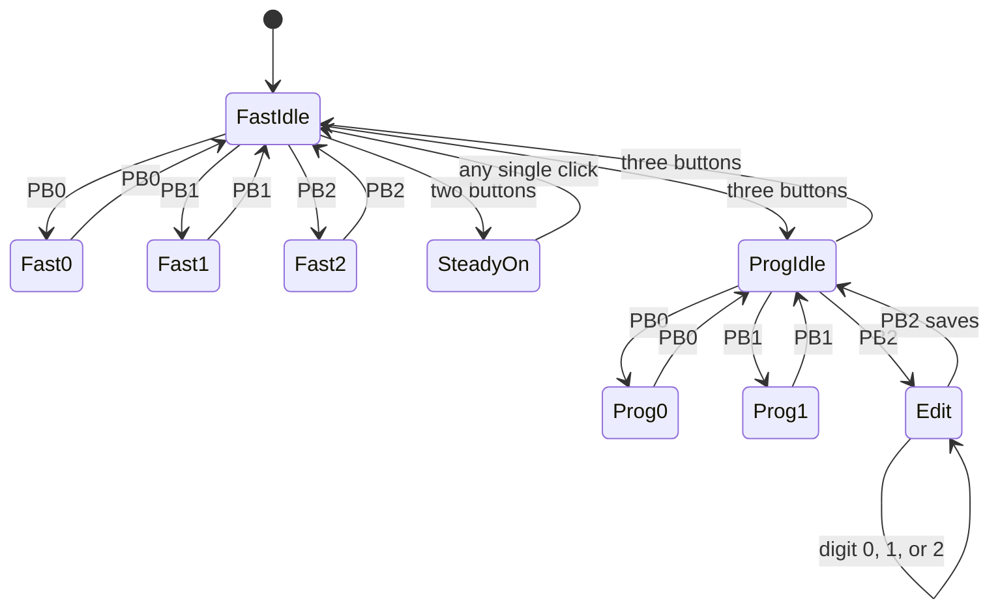

# ENCM 511 Assignment 3: first code draft

Date: 2026-10-13. Group members: (insert names and UCIDs).

This implements Part 2 using the supplied main file's configuration pragmas
and UART2 pin/baud choices. It is a source bundle to add to an MPLAB project,
not an already packaged MPLAB project or a compiled HEX file.

## Build and connect

1. Create/open an MPLAB X project for **PIC24FJ256GA702** with **XC16**.
2. Add `main.c`, `app.c`, `buttons.c`, and this bundle's `uart.c` to Source Files.
3. Add `app.h`, `buttons.h`, and this bundle's `uart.h` to Header Files.
4. Exclude the old main and old UART source from the build. There must be only
   one `main()` and one copy of each interrupt handler. Do not add
   `tests/test_logic.c` to the firmware project.
5. Replace the group-member placeholders before submitting.
6. Build, program, and open an ANSI-capable serial terminal at **9600 baud,
   8 data bits, no parity, 1 stop bit, no flow control**. Disable local echo
   and use a mode that sends each key immediately, rather than waiting for Enter.

| Signal | MCU connection | Assumption |
|---|---|---|
| PB0 | RA4 | Press connects input to ground |
| PB1 | RB8 | Press connects input to ground |
| PB2 | RB9 | Press connects input to ground |
| LED0 | RB5 | High turns LED on, with the existing series resistor |
| USB adapter RX | RB10 / RP10, pin 21 | MCU UART2 transmit |
| USB adapter TX | RB11 / RP11, pin 22 | MCU UART2 receive |
| USB adapter GND | Circuit GND | Common signal reference |

The physical pin numbers above assume the lab's 28-pin package. Use a
logic-level UART adapter compatible with the board. Internal button pull-ups
are enabled. If your LED is active low, swap `LED_ON` and `LED_OFF` in main.c.

## Implemented behavior

All intervals mean time ON and time OFF, not the total blink period.

| Mode | Input | Result |
|---|---|---|
| Fast | PB0 click | 250 ms on/off; PB0 again returns to idle |
| Fast | PB1 click | 500 ms on/off; PB1 again returns to idle |
| Fast | PB2 click | 1000 ms on/off; PB2 again returns to idle |
| Fast | Any two-button gesture | LED continuously on, message names the pair |
| Fast, steady-on | Any new single-button click | Return to idle |
| Fast idle | All three together | Enter Prog idle, LED off |
| Prog | PB0 click | 3000 ms on/off; PB0 again returns to idle |
| Prog | PB1 click | Blink at saved setting; PB1 again returns to idle |
| Prog | PB2 click | Enter setting editor, LED blinks at 125 ms on/off |
| Prog editor | Keyboard 0, 1, or 2 | Immediately update displayed pending setting |
| Prog editor | PB2 click | Save pending setting, return to idle |
| Prog | Any two-button gesture | No action |
| Prog idle | All three together | Enter Fast idle, LED off |

Settings: **0 = 250 ms, 1 = 500 ms, 2 = 1000 ms**. Power-up setting is 0.
Every state entry and actual setting change redraws the same terminal line.
The exact assignment messages are generated by `App_Status()`.

## Decisions for unspecified cases

- Single-button actions use a full debounced press and release, including
  returning to idle and saving the editor. Holding a single button does not
  trigger repeated actions or start a blink.
- While blinking or editing, a different single button is ignored. Click the
  active button to return to idle before choosing another function.
- A pair overrides any Fast state. Another pair can change the displayed pair.
  A repeated identical pair does not resend the message. In Prog, pairs do
  nothing, including during editing and blinking.
- All three buttons change modes only in idle. Elsewhere, the whole gesture
  is ignored, including its staggered release.
- Every accepted edge starts a 20 ms quiet period for the whole button group.
  After debounce, a multi-button gesture gets an 80 ms collection window from
  the latest additional press, so a third button can join without first
  producing a two-button action. For the demo, press the intended buttons
  together and hold for about 0.15 seconds, then release all of them.
- Once a multi-button event is emitted, all buttons must be released before
  another event is allowed. This prevents release order from producing clicks
  or switching modes back immediately. Presses added after the collection
  window has committed are part of the consumed gesture and are ignored.
- A short multi-button gesture that is debounced but released before the
  collection window ends is handled once upon final release. If pairs change
  before commitment, the latest actual simultaneous pair wins. An observed
  three-button combination has priority. Merely touching all three at separate
  times never synthesizes an all-three event.
- Each blink starts ON with a fresh countdown. Idle always turns the LED off.
- Invalid keyboard characters and Enter are ignored. Re-entering the same digit
  does not redraw the screen. Keyboard input outside the editor is discarded.
- Saving means saving in RAM. Settings survive mode changes but reset on power
  loss or MCU reset; the PDF does not require nonvolatile storage.
- If keyboard and a save click are processed in the same pass, characters
  already in the RX queue are applied before the save.

## Where the code lives

| File/function | Responsibility |
|---|---|
| main.c / Board_Init | GPIO, pull-ups, both-edge IOC, Timer1 initialization |
| main.c / main | Receive queued characters, process button events, redraw status, enter Idle |
| main.c / ApplyLED | Set LED state and blink countdown after a state change |
| main.c / _IOCInterrupt | Clear pin flags, snapshot button inputs and edge time |
| main.c / _T1Interrupt | Advance time and toggle LED at the required interval |
| buttons.c / Buttons_Update | Debounce IOC snapshots and recognize clicks/chords |
| app.c / App_ButtonEvent | Mode and state transitions |
| app.c / App_Character | Validate pending setting digits |
| app.c / App_Status | Build the assignment's terminal message |
| uart.c | UART2 initialization and interrupt-driven transmit/receive queues |

No ISR calls a function. The RX ISR has a bounded loop of at most four FIFO
reads and never waits for another byte. The other ISRs have no loops. There
are no software delay loops or `__delay` calls in the firmware.

The button ports are read once at startup and thereafter only in the IOC ISR.
The foreground examines RAM snapshots, not live input ports. Timer1 never
reads the ports. `__builtin_pwrsav(1)` emits the Idle instruction. The 1 ms
interrupt wakes the CPU for short processing; it also bounds a possible
interrupt-before-Idle race to one tick. This is a simple first-draft design,
not an attempt at the lowest possible interrupt rate.

## State diagram

Single-button arrows below mean a click. Pair events are additionally allowed
from any active Fast blink state; those three equivalent arrows are described
here to keep the diagram readable. All unlisted inputs leave the state unchanged.

## Timing and UART notes for the later report

With the starter's nominal 8 MHz FRC, FCY = FOSC/2 = 4 MHz.
Timer1 uses FCY, a 1:1 prescaler, and PR1 = 3999:

`tick = (PR1 + 1) / FCY = 4000 / 4000000 = 1 ms`

Software countdowns of 125, 250, 500, 1000, or 3000 ticks give the specified
half-periods. Their actual accuracy follows the FRC oscillator. The initial
half-period can be up to one tick shorter because a state change is asynchronous
to Timer1; later half-periods use the complete tick count.

The provided UART has BRGH = 1 and U2BRG = 103. At nominal FCY = 4 MHz:

`actual baud = FCY / [4 * (U2BRG + 1)] = 9615.3846 baud`

`error = (9615.3846 - 9600) / 9600 * 100 = +0.1603%`

The supplied files contain one preconfigured baud rate: 9600 baud. This
calculation excludes oscillator tolerance. The new UART keeps that setting.

In the original `XmitUART2`, setting UTXEN enables transmission. Its UTXBF loop
waits for room in the transmit FIFO, writing U2TXREG queues the character,
and repeatNo counts how many copies remain. The TRMT loop waits until both
the FIFO and shift register are empty, then UTXEN disables transmission.
Those waits block the foreground and are removed in this Part 2 implementation.

The editor does not call `RecvUartChar` or wait for Enter. Received bytes go
into an ISR-managed queue; main consumes available bytes and returns to Idle.
Timer1 keeps blinking the LED independently, even if no key ever arrives.

Each display write begins with carriage return and ANSI erase-line
(`\r\x1b[2K`). There are no transmitted line feeds. An ANSI terminal at
least 64 columns wide avoids visual wrapping of the messages.

## Changes from the supplied code

- Preserved the configuration pragmas, digital-pin setup, LED pin, UART2 pin
  mapping, and baud-rate choice. Explicitly disabled the software watchdog.
- Replaced the demonstration loops with an interrupt-driven state machine.
- Added IOC handling, debounce, chord handling, Timer1 blinking and Idle.
- Added explicit PPS unlocking/locking and UART pin directions.
- Replaced blocking transmit/receive functions with asynchronous queues.
- Removed the UART RX ISR's LED toggle so typing cannot disturb blink timing.
- Removed string-library dependence, the extra transmitted string terminator,
  and the original receive routines' use of uninitialized `last_char`.
- ISR-shared fields are volatile. Related input snapshots and LED updates are
  protected against interrupts during their short critical sections.
- TX retains complete queued lines; if temporarily full, main retries later.
  RX has a 31-character usable software queue, rejects framing/parity errors,
  discards newest bytes on software overflow, and recovers from hardware overrun.

## Validation completed and next hardware checks

Host GCC tests passed **230 assertions** covering Fast and Prog transitions,
every saved setting, pair messages, invalid input, press/release bounce,
staggered chord release, triple-button priority, and 16-bit tick rollover.
Address and undefined-behavior sanitizers were enabled; leak checking was
disabled because the execution environment does not support it. No dynamic
allocation is used. These tests compile the real app.c and buttons.c.

**Not yet verified:** XC16 build, device headers, actual UART traffic, ISR
execution timing, physical switch bounce, and measured LED timing. XC16 and
the physical board are unavailable in this environment. The host tests do
not simulate PIC peripheral registers or verify the UART ISR implementation.

First hardware pass:

1. Confirm startup says `Fast Mode: IDLE` and LED is off.
2. Try each Fast click twice. Hold a single button before releasing it to
   confirm it does not start blinking until release.
3. Test all three pairs, stagger their releases, then click any single button
   to return to idle. Confirm no intermediate single-button message.
4. From idle, hold all three together, release in stages, and confirm exactly
   one switch to Prog idle.
5. Test Prog PB0, including cancelling well before the 3-second interval ends.
6. Enter the PB2 editor, type `0`, `1`, `2`, then an invalid key. Confirm
   same-line updates and uninterrupted 125 ms blinking.
7. Click PB2 to save; click PB1 and check the selected interval. Repeat for
   all three settings, including saving without entering a new digit.
8. Check pairs do nothing in Prog. Return to idle and use all three to go back.

The final assignment still needs your hardware demonstration, packaged MPLAB
project, short PDF report, and group work form. This bundle supplies the code
draft and notes to support those steps; it is not the complete submission.

Hardware reference: Microchip PIC24FJ256GA705 Family Data Sheet DS30010118E,
sections 11.3 (IOC), 11.5 (PPS), 12 (Timer1), and 19 (UART).
https://www.microchip.com/content/dam/mchp/documents/MCU16/ProductDocuments/DataSheets/PIC24FJ256GA705-Family-Data-Sheet-DS30010118E.pdf
